### Hi, I'm Gabriel Araújo 👋
 
Computer Science student at CESAR School
 
I like understanding how systems work, and how they break. I'm currently learning how to attack and defend software.
 
- 🌐 Backends with **Django** and **Spring Boot**, with automated tests and production deployment
- 🔐 Security labs with **Kali Linux**, simulating attacks and studying mitigation
- 🤝 Team projects organized with **Agile** methods, **Kanban** and **Scrum**
## 💻 Skills
 
#### Languages
 

 
#### Backend and Web
 

 
#### Data, Cloud and DevOps
 

 
#### Security
 

 
## 📚 Currently Learning
 
- 🛡️ Cybersecurity and Pentest fundamentals
- 🌍 Networking
## 📫 Contact
 
- LinkedIn: [Gabriel Araújo](https://www.linkedin.com/in/gabrielvaraujo/)
- Email: gvag@cesar.school
---
 
<picture>
  <source media="(prefers-color-scheme: dark)" srcset="https://raw.githubusercontent.com/biel578/biel578/output/github-contribution-grid-snake-dark.svg">
  <source media="(prefers-color-scheme: light)" srcset="https://raw.githubusercontent.com/biel578/biel578/output/github-contribution-grid-snake.svg">
  
</picture>
 
